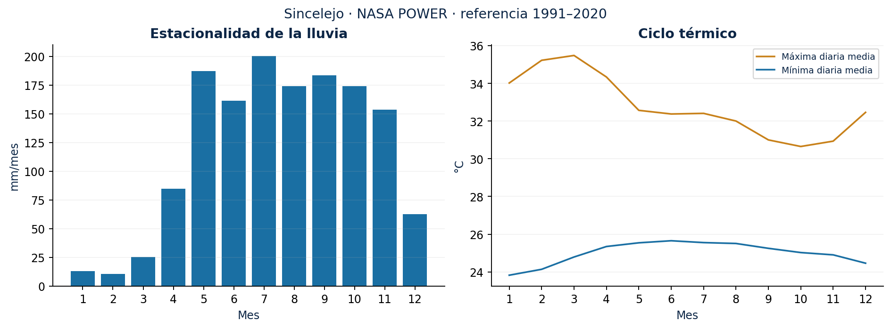

## Producto y escala

Se consultó NASA POWER para el punto 9,3047° N, 75,3978° O: seis variables diarias entre el 1 de enero de 1991 y el 31 de diciembre de 2025. La respuesta indica fuentes **MERRA2 y POWER**, API v2.10.1 y tiempo solar local **LST**. La documentación sitúa la meteorología en una rejilla de 0,5° × 0,625° [@power; @powergrid]. La coordenada es una consulta regional, no un sensor ni un promedio municipal.

| Campo | Unidad | Interpretación |
|---|---|---|
| T2M | °C | Temperatura media diaria del aire a 2 m |
| T2M_MAX / T2M_MIN | °C | Máxima / mínima diaria del aire |
| PRECTOTCORR | mm/día | Precipitación diaria corregida del producto |
| RH2M | % | Humedad relativa diaria |
| WS10M | m/s | Velocidad media diaria del viento a 10 m; no ráfaga |

## Definiciones implementadas

- **Rx1day:** mayor precipitación diaria del año.
- **Rx5day:** mayor suma de cinco días consecutivos dentro del mismo año.
- **R20:** número de días con precipitación ≥20 mm.
- **CDD:** mayor racha de días con precipitación <1 mm dentro de cada año calendario. Una racha que cruza diciembre–enero se divide.
- **TX35 y TN25:** días con máxima ≥35 °C y noches con mínima ≥25 °C. Son umbrales exploratorios, no umbrales clínicos validados.
- **TX90 mensual:** máxima superior al percentil 90 del mismo mes en 1991–2020. Es una simplificación mensual, no el TX90p ETCCDI con ventana móvil diaria.
- **Z-P3:** anomalía estandarizada de lluvia acumulada de tres meses, calculada por mes de cierre respecto a 1991–2020, con desviación muestral. No ajusta una distribución ni evapotranspiración: **no es SPI ni SPEI**.
- **Seco–cálido:** coincidencia diaria de lluvia <1 mm y máxima sobre el percentil mensual de referencia. No es una probabilidad de incendio.

Se validan calendario, rellenos, rangos y consistencia térmica. No se imputan datos. Las tablas resultantes están en `data/processed/`. Las decisiones de umbral, referencia y reinicio anual están también en el código y en sus pruebas.

**Validación.** Un contraste con la estación IDEAM Puerta Roja (2017–2021) muestra acuerdo diario bajo y más días húmedos en el reanálisis; vea [2.7](27_validacion_ideam.md) antes de interpretar rachas secas o extremos.
