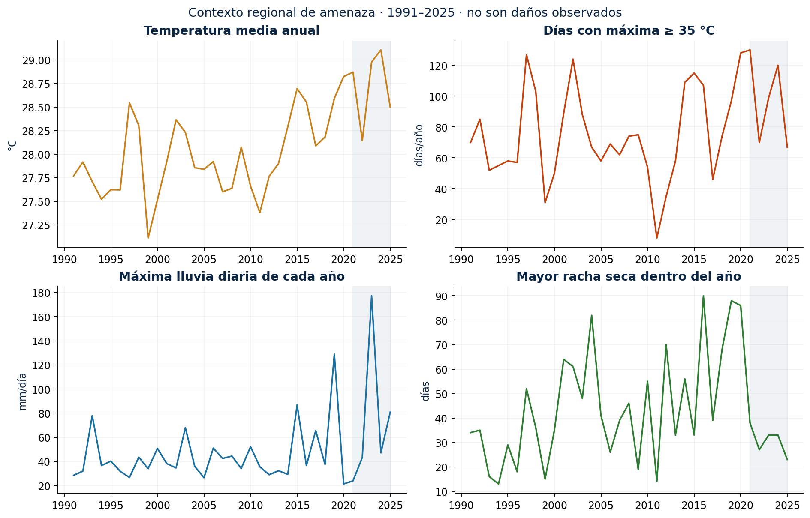

**Sincelejo · Sucre · Colombia**  
Diagnóstico territorial, evidencia y análisis reproducible · Edición del 1 de noviembre de 2026

## Resumen

**Problema.** Sincelejo combina riesgos asociados al drenaje de arroyos, la seguridad hídrica, las laderas y la salud. La evaluación debe incluir también calor, fuego, tormentas y sismo, además de las dependencias entre agua, energía, movilidad y atención.

**Objetivo.** Identificar los principales mecanismos de riesgo, calcular indicadores climáticos de contexto y establecer qué información y medidas permiten avanzar hacia una evaluación local de impactos. El libro conserva la estructura y la identidad visual **EVA** de Leticia y aplica críticamente el marco del libro de teoría.

**Métodos.** Se analizaron **35 años y 12,784 días** de NASA POWER (1991–2025), con referencia 1991–2020, seis variables diarias, control de calidad y datos originales preservados. La evidencia se contrasta con el Plan de Desarrollo 2024–2027, CARSUCRE, DANE, IDEAM, SGC, INS e IPCC. Los ocho flujos incluyen descripción, amenaza, riesgo, escenarios y medidas; **28 cuadernos** contienen código y salidas reproducibles.

## Resultados principales

| Resultado calculado | Valor | Cómo interpretarlo |
|---|---:|---|
| Temperatura media de referencia | 28.0 °C | Promedio del reanálisis, 1991–2020 |
| Precipitación anual de referencia | 1433 mm/año | Contexto regional, no lluvia de cada barrio |
| Pendiente lineal de temperatura media | +0.30 °C/década | Descripción de 1991–2025, sin atribución causal |
| Días con máxima ≥35 °C | 74.2/año en 1991–2020; 97.2 en 2021–2025 | El bloque reciente tiene solo cinco años; umbral exploratorio |
| Mayor racha con lluvia <1 mm/día | 90 días, 2016 | Racha dentro del año calendario; probable límite inferior, pues el reanálisis tiene más días débilmente húmedos que la estación ([2.7](book/02_datos/27_validacion_ideam.md)) |
| Máximo diario de lluvia del registro | 177.33 mm, 2023 | Máximo del reanálisis; el contraste con la estación IDEAM disponible (2017–2021) no cubre ese año ([2.7](book/02_datos/27_validacion_ideam.md)) |

**Diagnóstico de riesgo.** Las fuentes territoriales orientan inspecciones de arroyos y laderas, y el análisis de continuidad del agua. El corte de dengue aporta evidencia sanitaria, pero no una serie predictiva. El calor presenta una señal que merece medición urbana y evaluación de exposición. Para sismo, incendios y vendavales se documenta el procedimiento y la información requerida.

:::{important} Alcance de los resultados
Los números anteriores son indicadores meteorológicos regionales. Esta edición no estima pérdidas monetarias, mortalidad atribuible ni población inundada. Es un diagnóstico exploratorio con componentes cuantitativos de amenaza y sensibilidad, no una zonificación oficial de riesgo ni un estudio predial. Las brechas se identifican en cada flujo.
:::

## Del diagnóstico a la acción

La propuesta es comenzar por **drenaje y laderas documentadas**, **continuidad de agua y energía**, y **medición de calor y vigilancia sanitaria**. En paralelo, completar inventarios de activos, fuego, tormentas y vulnerabilidad sísmica de instalaciones esenciales. La prioridad se fundamenta en evidencia, consecuencias potenciales y dependencias; no se presenta como un ranking monetario.

Las pruebas de sensibilidad muestran cómo cambian los indicadores bajo perturbaciones elegidas. Se mantienen separadas de las proyecciones climáticas de IDEAM, cuyos valores locales aún deben extraerse y evaluarse con un ensamble.

## Cómo recorrer el libro

| Sección | Pregunta que resuelve |
|---|---|
| [1. Conceptos y evidencia](book/01_conceptos/index.md) | ¿Qué llamamos riesgo y qué sabemos realmente? |
| [2. Fuentes de datos](book/02_datos/index.md) | ¿De dónde vienen las cifras y a qué escala son útiles? |
| [3. Análisis](book/03_analisis/index.md) | ¿Cómo cambia la amenaza, qué puede afectarse y qué medidas comparar? |
| [Síntesis](book/03_analisis/39_sintesis.ipynb) | ¿Qué acciones y datos priorizar? |
| [Riesgos compuestos](book/03_analisis/310_multiamenaza.ipynb) | ¿Cómo pueden encadenarse fallas de distintos sistemas? |
| [Reproducibilidad](book/recursos/colab.md) | ¿Cómo ejecutar y actualizar el análisis? |

## Créditos y fuentes

Autor del proyecto: **Mauricio Romero**. Estructura y diseño adaptados del [libro EVA de Leticia](https://github.com/mromerot/leticia); marco conceptual adaptado del libro local `teoria`, con trazabilidad en [la revisión crítica](book/01_conceptos/18_revision_literatura.md). Las fuentes externas se identifican en el [catálogo](book/02_datos/25_catalogo.md) y en las citas de cada capítulo. Contenido propio CC BY 4.0 y código MIT; los datos de terceros conservan sus condiciones.
